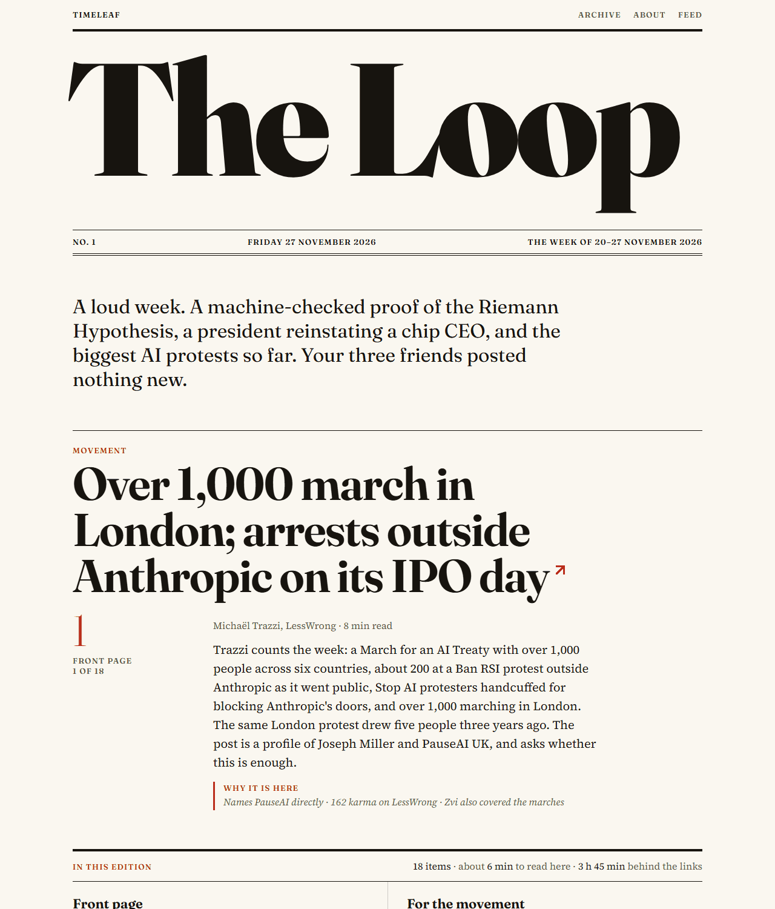
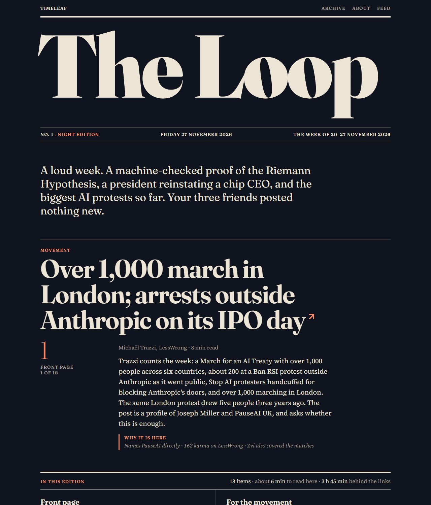
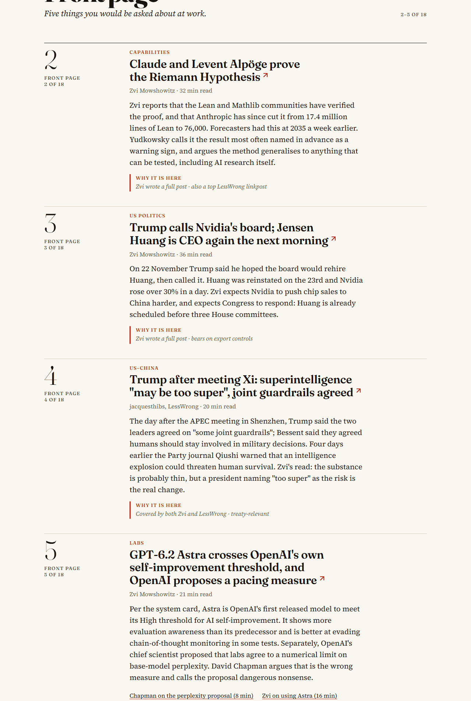
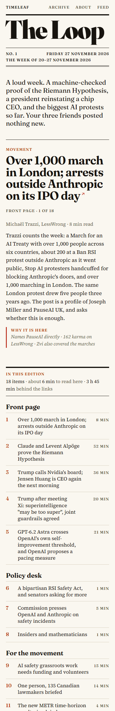
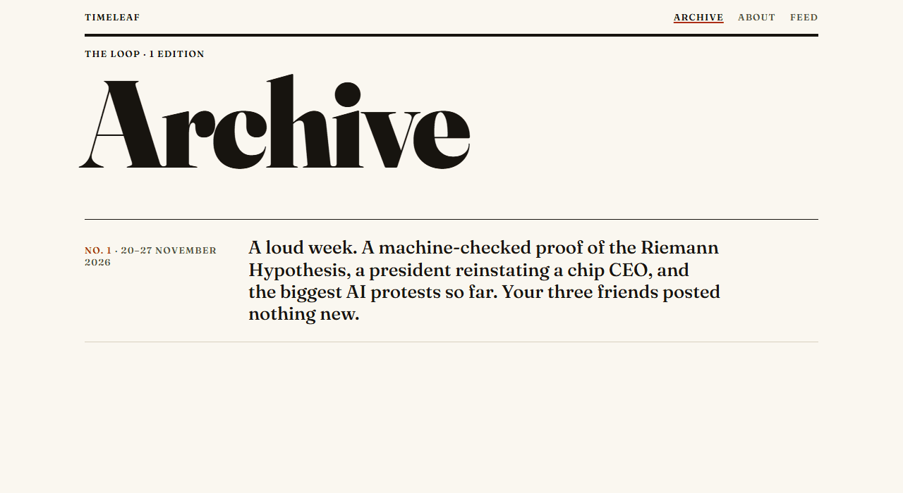
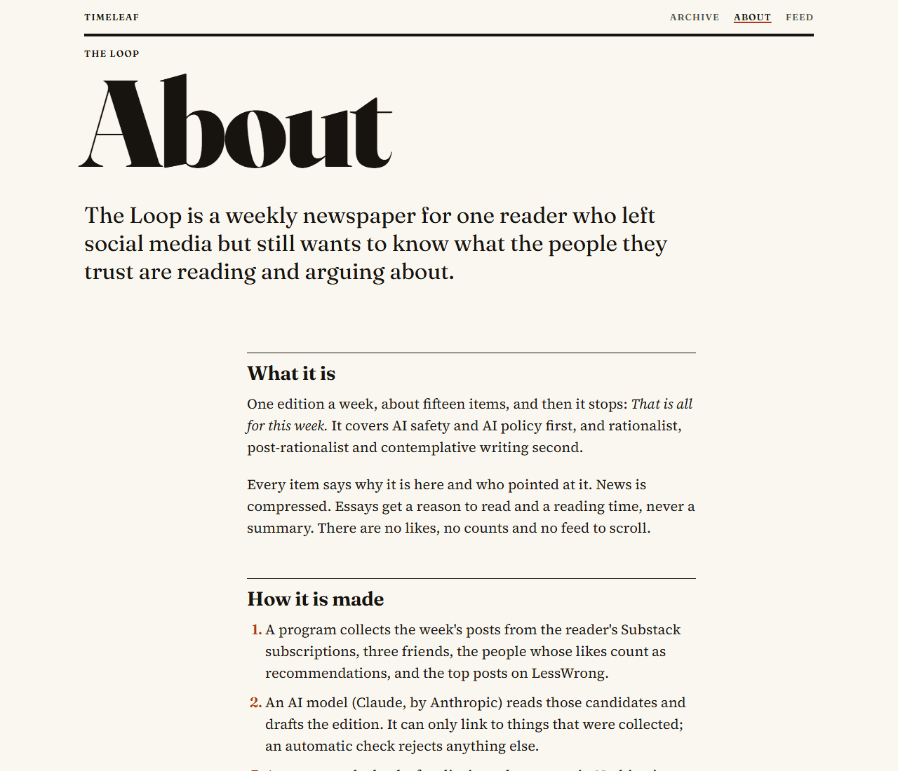

# Design: "Edition"

**Status:** Implemented 2026-11-28 (proposal [0003](proposals/0003-design-direction.md), direction B; see [DECISIONS.md](proposals/DECISIONS.md) note 4)
**Serves:** design values 13–15 and US-1, US-11, US-12 in [PRINCIPLES.md](PRINCIPLES.md)
**Lives in:** `src/timeleaf/build/static/style.css`, `src/timeleaf/build/templates/`, `contents()` in `src/timeleaf/build/render.py`

## The idea

A paper is recognised by its rituals, not by its material. So the page keeps the rituals (a masthead, a dateline, a lead story, an index of the whole edition, section openers, a definite end) and draws all of them with only two things: type and rules. There are no boxes, cards, shadows, icons, images or textures. The paper's name is set as a poster in a heavy, high-contrast serif; everything you read is in one calm column of a plain text serif; one vermilion accent marks what is a label, a number or a link. At night the same page becomes a night edition: deep ink-blue paper with cream type, chosen as its own palette. When striking and usable conflict, usable wins.

What was taken from the references, as principles rather than looks:

- **Asterisk:** identity carried almost entirely by type at confident sizes on warm paper; a narrow reading column set off-centre with a quiet margin beside it; links as a thin underline; next to no chrome.
- **Gi Effektivt:** a lot of air; hairline rules on top of each block instead of boxes around them; one colour doing all the work.

What is Timeleaf's own: the poster masthead with its double-rule dateline, the numbered index on the cover whose numbers reappear in the margin beside each item, the italic "why it is here" line, and the closed ring before the last words.

## Tokens

### Type

Two families, both SIL OFL 1.1, self-hosted as WOFF2 in `static/fonts/` (licence text in `LICENSE-OFL.txt`). No monospace anywhere.

| Role | Family | Why |
|---|---|---|
| Display | **Fraunces** (variable: optical size 9–144, weight 100–900) | One file gives the whole display voice. At optical size 144 and weight 900 it is a nameplate; at headline sizes the same file is a sturdy, slightly soft serif; at 13 px in capitals it makes the labels. It is what makes a screenshot recognisable |
| Text | **Source Serif 4** (400, 400 italic, 600) | Quiet, wide enough to read at length, good figures. The italic is the voice of the "why" line and the section notes. 600 is declared for long-form articles and is only downloaded by pages that use bold |

Files come from fontsource at pinned versions, latin and latin-ext subsets, each with its `unicode-range`:

- `https://cdn.jsdelivr.net/npm/@fontsource-variable/fraunces@5.3.0/files/fraunces-{latin,latin-ext}-opsz-normal.woff2` (saved as `fraunces-{subset}-opsz-wght.woff2`)
- `https://cdn.jsdelivr.net/npm/@fontsource/source-serif-4@5.3.1/files/source-serif-4-{latin,latin-ext}-{400-normal,400-italic,600-normal}.woff2`

Scale (rem; 1rem = the reader's browser setting, normally 16 px):

| Token | Size | Face | Used for |
|---|---|---|---|
| Masthead | `min(22vw, 260px)`; 13vw / 9.5vw for longer names; wraps if it must | Fraunces 900, opsz 144, line-height .86, tracking −.03em | The paper's name (`h1`) |
| End | `clamp(3rem, 1.5rem + 8vw, 7.5rem)` | Fraunces 900, opsz 144 | "That is all for this week." |
| Page title | `clamp(4rem, 2rem + 13vw, 11rem)` | Fraunces 900, opsz 144 | Archive, About, 404 |
| Section | `clamp(2.5rem, 1.6rem + 4.6vw, 4.5rem)` | Fraunces 800, opsz 144 | Section openers |
| Lead | `clamp(2.25rem, 1.2rem + 5.2vw, 4.75rem)` | Fraunces 650 | The lead headline |
| Lede | `clamp(1.375rem, 1rem + 1.6vw, 2rem)` | Fraunces 400, line-height 1.25 | The week in a sentence |
| Headline | `clamp(1.5rem, 1.25rem + 1.1vw, 1.9375rem)` | Fraunces 600, line-height 1.12 | Item headlines (`h3`) |
| Body | 1.125rem (18 px) on phones, 1.25rem (20 px) from 720 px; line-height 1.55 | Source Serif 4 400 | Everything you read |
| Small | 1rem | Source Serif 4 | Source line, why-line, colophon, index total |
| Label | .875rem (14 px), capitals, tracking .08em | Fraunces 600 | Kickers, dateline, orientation, navigation, reading times |

Headlines use `text-wrap: balance` and running text `text-wrap: pretty`, so headlines do not end on a single short word.

### Colour

One fixed look for every paper. Ratios are WCAG 2.2 contrast against paper / against wash, and are enforced by `test_palette_meets_wcag_in_both_modes`.

**Day edition**

| Token | Value | On paper | On wash | Used for |
|---|---|---|---|---|
| `--paper` | `#faf7f0` | | | Page |
| `--wash` | `#f1ecdf` | | | Form fields |
| `--ink` | `#17140f` | 17.17 (AAA) | 15.57 (AAA) | Text, headlines, heavy rules |
| `--muted` | `#585146` | 7.32 (AAA) | 6.64 (AA) | Source lines, why-text, colophon, orientation |
| `--accent` | `#b92d14` | 5.69 (AA) | 5.16 (AA) | Kickers, index numbers, link underline, hover, focus ring, the why rule, the end ring |
| `--rule` | `#d8d0bf` | 1.43 | | Hairlines between items (decoration only, never the sole carrier of meaning) |

**Night edition** (`prefers-color-scheme: dark`)

| Token | Value | On paper | On wash |
|---|---|---|---|
| `--paper` | `#10141f` | | |
| `--wash` | `#191f2e` | | |
| `--ink` | `#ece5d5` | 14.66 (AAA) | 13.11 (AAA) |
| `--muted` | `#a8a293` | 7.23 (AAA) | 6.47 (AA) |
| `--accent` | `#ff8a6b` | 7.97 (AAA) | 7.13 (AAA) |
| `--rule` | `#333a4d` | 1.62 | |

The night edition is a designed palette: blue-black instead of black, cream instead of white to cut glare, and a warmer, lighter vermilion. It applies under `prefers-color-scheme: dark` unless the page carries `data-theme="light"`, and always under `data-theme="dark"`.

### Space and measure

| Token | Value | Used for |
|---|---|---|
| `--s1` … `--s6` | 8, 16, 24, 40, 64, 104 px | All vertical rhythm |
| `--gutter` | 20 px; 40 px from 720 px | Page side padding (never less than the safe-area inset) |
| `--measure` | 32em | Reading column: about 66 characters at 20 px (40 on a 390 px phone) |
| `--rail` | 13rem | Left margin for item numbers, from 960 px |
| Page | max 1120 px | Mastheads, index and rules run the full width; reading stays in the measure |

Rules: 4 px ink (masthead top, index top, section openers, the end), 1 px ink (dateline, first item of a section), 4 px double ink (under the dateline), 1 px `--rule` (between items and index lines).

## Components

- **Top navigation.** Site name left, Archive / About / Feed right, in label type. Each link is at least 48 px tall. The current page is marked with `aria-current` and an accent underline.
- **Masthead.** A 4 px rule, the paper's name on one line filling the width, then the dateline between a hairline and a double rule: edition number, weekday and date, the week covered. Names longer than 9 or 16 characters step down a size and may wrap (class `mid` / `long`), so per-reader paper names fit without scripts.
- **Lede.** The edition's one-paragraph summary, large, directly under the dateline.
- **Lead story.** The first item, lifted onto the cover: kicker, a very large headline, then the item as usual. Its number in the rail is in the accent. The first section, further down, continues from item 2.
- **Index** (`nav`, labelled "In this edition"). The total line reads "18 items · about 6 min here · 3 h 45 min if you open everything". Then every section with its items: number, headline, reading time. Each line is one link (at least 48 px tall) to the item's anchor (`#item-N`). One column on phones; two newspaper columns with a hairline between them from 720 px. Items without a reading time get an estimate from their body at 230 words a minute.
- **Section opener.** Full-width 4 px rule, the section name in large display type, its note in italic, and the range it covers ("6–8 of 18").
- **Item.** Orientation ("Policy desk · 4 of 18"), kicker in the accent, headline, source and reading time, body, further links, why-line. From 960 px the orientation moves into the left rail under a large light numeral that matches the index number. Headlines are not underlined; a small drawn arrow in the accent marks one that leaves the paper, and hover or keyboard focus turns it accent-coloured and underlined.
- **Why-line.** "Why it is here" on every item that has a reason. It is visibly a different voice: italic, muted, one size down, with a label in accent capitals and a 3 px accent rule on its left.
- **End mark.** A 4 px rule, a closed ring in the accent (the loop, closed), then "That is all for this week." at near-masthead size. Nothing follows it but the colophon.
- **Colophon.** "What was checked", "What it cannot see" and, when known, "How it was made": small columns, each under its own hairline. Then the pager: previous and next edition, back to the index, all editions.
- **Archive row.** Edition number (accent) and week in label type; the edition's lede in display type as the link. Hairlines between rows.
- **Long-form article** (`.prose`: the about page today, the in-app reading room later). Text in the measure at body size; `h2` in Fraunces 650 under a hairline, `h3` smaller without one; paragraphs separated by 1.1em of space, no indents; links underlined in the accent; list markers in the accent; block quotes in italic behind a 3 px accent rule; bold in Source Serif 600; images never wider than the column. An article opens with a `.page-head` (label, then the title in page-title or lead size) and should end with the ring.

## Usability rules

These are not negotiable. When a design idea breaks one, the idea goes.

| Rule | Target | How it is met |
|---|---|---|
| Body text | ≥ 18 px on phones; 60–72 characters a line on wide screens | 1.125rem / 1.25rem; `--measure: 32em` |
| Contrast | WCAG 2.2 AA for all text in both modes, AAA for body text | Tables above; checked by a test |
| Tap targets | ≥ 44 × 44 px for navigation and index links | 48 px minimum height on nav, index and pager links; 44 px on further links |
| Weight | ≤ 150 KB transferred per page including fonts; no layout shift | The edition page is about 119 KB: HTML 7 KB and CSS 4 KB gzipped, three font files 107 KB (Fraunces 67, Source Serif regular 20 and italic 20). The two fonts used above the fold are preloaded; fallback faces are size-adjusted to the web fonts' average character width so text wraps the same before and after they arrive; line heights are fixed |
| JavaScript | None | The Content-Security-Policy says `script-src 'none'` |
| Motion | None unless the reader starts it | No transitions or animations; `prefers-reduced-motion` is honoured anyway |
| Structure | One `h1`, semantic headings, skip link, visible focus, `lang`, labelled index | `h1` is the paper's name; lead, index and sections are `h2`; items are `h3`; 3 px accent focus ring; the index is a `nav` with ordered lists |
| Links | Recognisable without colour alone | Underlined in running text; headlines are marked by position, size and the arrow, and gain an underline on hover and focus |
| Privacy | Nothing from other servers | Fonts and styles are served from the site; no inline styles or scripts (strict CSP) |

Known limits: the fallback faces are matched against Georgia, so on devices without it (most Android phones) a slow first load can re-wrap text once when the fonts arrive. Editions that need latin-ext characters download an extra 60 KB Fraunces subset and would pass the 150 KB target.

## Screens

Edition 1, rendered at review on 2026-11-28.

| | |
|---|---|
| Front page, day |  |
| Front page, night edition |  |
| Items with numerals and why-lines |  |
| Phone (390 px), day |  |
| Archive |  |
| About |  |
